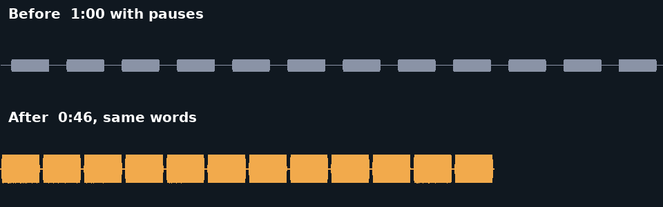
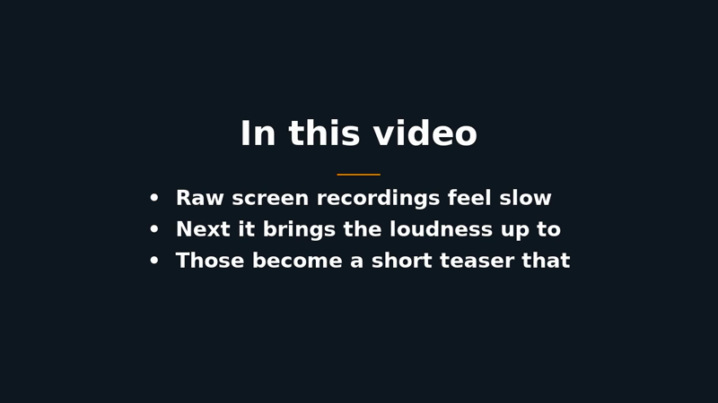
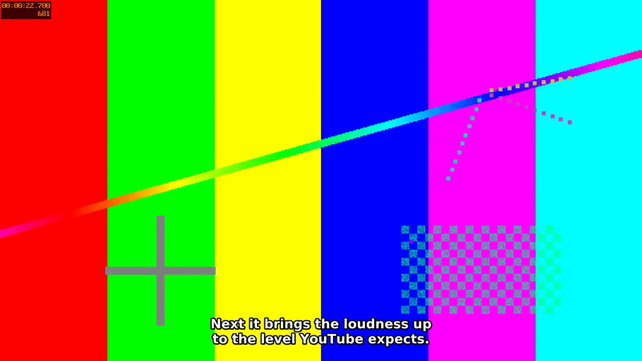

# Pare

[](https://github.com/gruz0/pare/actions/workflows/ci.yml)
[](LICENSE)

> **One command turns a raw screen recording into an upload-ready video.**\
> pauses cut · loudness fixed · captions burned in · teaser added · chapters written

```
$ pare recording.mkv subs.srt
recording.mkv: 1920x1080, 60 fps, 6:08
Finding pauses...
  6:08 -> 5:16: 52.1 s removed (14%) in 101 cuts
Asking the LLM for topics, highlights and chapters...
  Loudness: -39.0 -> -14 LUFS
Encoding main video  done in 2:30
Done in 3:09.
  recording.final.mp4      upload this
  recording.chapters.txt   paste into the description
  recording.plan.json      edit and re-run to change the teaser or chapters
  recording.cut.srt        subtitles matching the edited video
```



---

## Why this exists

I record ~10-minute tutorials in **OBS**: screen full-frame, webcam in the bottom-right corner. The raw recording is never something people enjoy watching, and the reasons are the same every time:

- **Dead air.** Pauses, "umm"s, moments of thinking. Cutting them by hand takes longer than recording.
- **Quiet, uneven audio.** A quiet upload sounds weak next to everyone else's.
- **No captions.** Plenty of people watch with the sound off. I have an SRT from Whisper, but once the pauses are cut it no longer lines up.
- **A weak opening.** Viewers decide in the first seconds. A short teaser helps, but picking the moments means rewatching the whole thing.
- **No chapters.** Writing them means rewatching again.

All of that is mechanical work. Pare does it with FFmpeg and an LLM that reads the transcript: no editor, no subscription, no OBS plugins.

## What it does

1. **Cuts the pauses.** Finds silence in the audio (and, if you want, gaps in the transcript) and removes it with jump cuts. Every cut is on a frame boundary and the audio is cut to the exact matching samples, so sound and picture stay in sync however many cuts there are.
2. **Fixes the loudness.** Two-pass normalisation to −14 LUFS, the level YouTube plays at.
3. **Re-times and burns in your captions.** Long lines are split into readable chunks, placed clear of a bottom-right webcam.
4. **Plans a teaser and chapters.** The LLM reads the re-timed subtitles and picks topics, a few punchy clips and chapter titles. Pare checks and repairs the answer in code, then saves it as a plain JSON file you can edit.
5. **Assembles the result.** An "In this video" card, the highlight clips, then the full video, plus a YouTube-ready chapter list.

Every step can be switched off or tuned. See [how it works](docs/how-it-works.md) for the details.

|                                                     |                                                           |
| --------------------------------------------------- | --------------------------------------------------------- |
|  |  |

_(Demo images are generated from a synthetic test pattern, not real footage.)_

## Install

Pare needs **FFmpeg**, a font, and **Python 3.11 or newer**. On Debian 12 or Ubuntu:

```bash
sudo apt update
sudo apt install -y ffmpeg fonts-dejavu-core python3 pipx git
pipx ensurepath

git clone https://github.com/gruz0/pare.git
cd pare
pipx install .
```

Open a new terminal (so `pipx`'s folder is on your `PATH`) and check:

```bash
pare --version
```

Pare itself has **no Python dependencies**: it only uses the standard library and calls `ffmpeg`.

For the AI step (topics, clips, chapters) you also need the **[Claude Code](https://claude.com/claude-code) CLI** (`claude`) installed and logged in. Without it, everything else still works: use `--no-ai`, or point `--llm-cmd` at another tool.

> **Tested on** Debian 12 (FFmpeg 5.1) and Ubuntu 24.04 (FFmpeg 6.1), including under WSL2. macOS should work with `brew install ffmpeg` but is not tested.

## Quick start (30 seconds, no footage needed)

From the cloned `pare` folder, make a synthetic one-minute "recording" and run Pare on it with a stand-in for the LLM:

```bash
examples/make_sample.sh
pare sample.mkv examples/sample.srt --llm-cmd examples/fake_llm.sh
```

You get `sample.final.mp4`, `sample.chapters.txt`, `sample.plan.json` and `sample.cut.srt` in the current folder. Open the video: the pauses are gone, captions are on, and it starts with a title card and three clips.

## Use it on your own recording

You need the recording and an SRT made from it by any Whisper tool:

```bash
pare recording.mkv subs.srt
```

Not sure what it will cut? Look first; this encodes nothing and sends nothing:

```bash
pare recording.mkv subs.srt --dry-run
```

Results are written next to the recording (or to `--output-dir`).

### Works great with Parley

[Parley](https://github.com/gruz0/parley) makes transcripts locally with WhisperX. **Parley transcribes, Pare edits:**

```bash
# in the parley folder: transcribe (SPEAKERS='1 1' = it is just you talking)
make transcribe FILE="$HOME/Videos/recording.mkv" SPEAKERS='1 1'

# then polish, pointing Pare at Parley's output folder
pare ~/Videos/recording.mkv --transcript transcripts/recording/
```

Pare picks up the `.srt` and, when it is there, the `.json` with word-level timing. With word timing a cut never lands inside a word, long captions are split exactly where a word starts, and you can add `--remove-fillers` to cut "um" and "uh". Speaker labels such as `[Alex]:` are stripped from captions (keep them with `--keep-speakers`).

Any other Whisper SRT works just as well; Parley is supported, not required.

## Common options

| Option                             | What it does                                                   | Default                           |
| ---------------------------------- | -------------------------------------------------------------- | --------------------------------- |
| `--dry-run`                        | Print the cut list and summary, then stop                      | off                               |
| `--no-cuts`                        | Keep the pauses                                                | off                               |
| `--silence-db DB`                  | Audio quieter than this counts as silence                      | −35, lowered for quiet recordings |
| `--min-silence SEC`                | Only cut pauses at least this long                             | 0.5                               |
| `--pad SEC`                        | Pause kept on each side of speech                              | 0.15                              |
| `--cut-by audio\|subs\|both`       | Take pauses from silent audio, transcript gaps, or both        | `audio`                           |
| `--remove-fillers`                 | Also cut "um", "uh" (needs word-level JSON)                    | off                               |
| `--audio-track N` / `--mix-tracks` | Which OBS audio track to use, or mix them all                  | track 1                           |
| `--lufs LUFS` / `--no-loudnorm`    | Loudness target, or leave the level alone                      | −14                               |
| `--no-captions`                    | Do not burn captions in                                        | off                               |
| `--caption-position`               | `bottom-center`, `bottom-left` or `top`                        | `bottom-center`                   |
| `--no-ai`                          | No LLM: no title card, clips or chapters                       | off                               |
| `--plan FILE`                      | Use this plan instead of asking the LLM                        | -                                 |
| `--clips N`                        | Number of highlight clips                                      | 3                                 |
| `--no-teaser`                      | No card or clips (chapters still written)                      | off                               |
| `--title-text TEXT`                | Card heading, e.g. in another language                         | "In this video"                   |
| `--llm-cmd CMD`                    | Any command that reads a prompt on stdin and prints the answer | `claude -p`                       |
| `--crf N` / `--preset NAME`        | x264 quality and speed                                         | 18 / `medium`                     |
| `--embed-chapters`                 | Also store chapters inside the MP4                             | off                               |
| `--keep-work`                      | Keep intermediates and reuse the main encode next run          | off                               |

`pare --help` lists everything, grouped, with defaults. [docs/tuning.md](docs/tuning.md) explains what to change when the result is not what you wanted.

Settings you always use can live in `./pare.toml` or `~/.config/pare/config.toml` (see [examples/pare.toml](examples/pare.toml)). Command-line flags win.

## Edit the plan and re-render

Pare never forces the AI's choices on you. `recording.plan.json` is plain JSON, with times in seconds on the _edited_ video:

```json
{
  "topics": ["Setting up the OBS scene", "Cutting pauses automatically", "Burning in captions"],
  "clips": [{ "start": 12.3, "end": 17.8, "why": "states the payoff" }],
  "chapters": [{ "start": 0, "title": "Why raw recordings feel slow" }]
}
```

Change a topic, swap a clip, rename a chapter, then render again:

```bash
pare recording.mkv subs.srt --plan recording.plan.json --keep-work
```

With `--plan` nothing is sent to an LLM and the same inputs give the same output. With `--keep-work` the slow main encode from the previous run is reused, so only the teaser is rebuilt: on a 9-minute recording that is about 30 seconds instead of 5 minutes. (Use `--keep-work` on the first run too, so there is something to reuse.) `recording.cut.srt` shows what is said when, which helps when picking times.

## Privacy

Everything runs on your machine. **The only thing that leaves it is the subtitle text**, which is sent to the LLM command (by default `claude -p`) to plan the teaser and chapters. No audio or video is ever uploaded.

With `--no-ai` or `--plan FILE`, nothing is sent anywhere.

## Troubleshooting

- **It cut into my words / the cuts feel too tight.** Raise `--pad` (try `0.25`), raise `--min-silence` (try `0.8`), or lower `--silence-db` (try `-45`). Giving Pare word-level timing (`--transcript` with a Parley folder, or `--words file.json`) stops cuts from landing inside words.
- **It barely cut anything.** There is probably background noise or music. Use `--cut-by subs`, or set a higher `--silence-db` (try `-30`). Pare warns when it suspects this.
- **`claude` was not found / the LLM step failed.** Install Claude Code and run `claude` once to log in, or run with `--no-ai`, or write a plan and pass `--plan`.
- **Captions cover something important.** Try `--caption-position top` or `bottom-left`, or change `--caption-margin`.
- **The wrong audio is used.** OBS can record several tracks; Pare prints which one it uses. Choose with `--audio-track N` or `--mix-tracks`.
- **No chapters file.** YouTube needs at least three chapters of 10 seconds or more. Very short videos cannot have them, so Pare writes none and says so.
- **The run failed half-way.** Your previous `final.mp4` is untouched: Pare writes to a temporary file and renames it only on success. Intermediates are in `<name>.pare-work/` next to the output and are reused or overwritten by the next run.

More in [docs/tuning.md](docs/tuning.md).

## FAQ

**Does Pare transcribe?** No. Bring an SRT from any Whisper tool; [Parley](https://github.com/gruz0/parley) is one way to make it.

**Can I use a different LLM?** Yes: `--llm-cmd "your-tool --flags"`. The command gets the prompt on stdin and must print the answer. Pare validates whatever comes back.

**How long does it take?** The video is encoded once. On my desktop a 6-minute 1080p60 recording takes about 3 minutes, most of it x264. `--preset veryfast` is quicker for drafts.

**Will it work on a one-hour recording?** It is built to: cutting is tested with thousands of cuts, and nothing is held in memory. The longest recordings it has actually been run on so far are about ten minutes; see [docs/decisions.md](docs/decisions.md).

**Why are the captions burned in?** So they show up everywhere, including autoplay with the sound off. If you prefer a separate caption track, use `--no-captions` and upload `recording.cut.srt`.

## Documentation

- [How it works](docs/how-it-works.md): the pipeline, step by step
- [Tuning](docs/tuning.md): which flag fixes which problem
- [Recommended OBS setup](docs/obs-setup.md)
- [Design decisions](docs/decisions.md): what was researched and measured, and why Pare works the way it does

## Contributing

Contributions are welcome. See [CONTRIBUTING.md](CONTRIBUTING.md). The tests need only FFmpeg: no footage, no GPU, no network.

## License

[MIT](LICENSE) © gruz0
