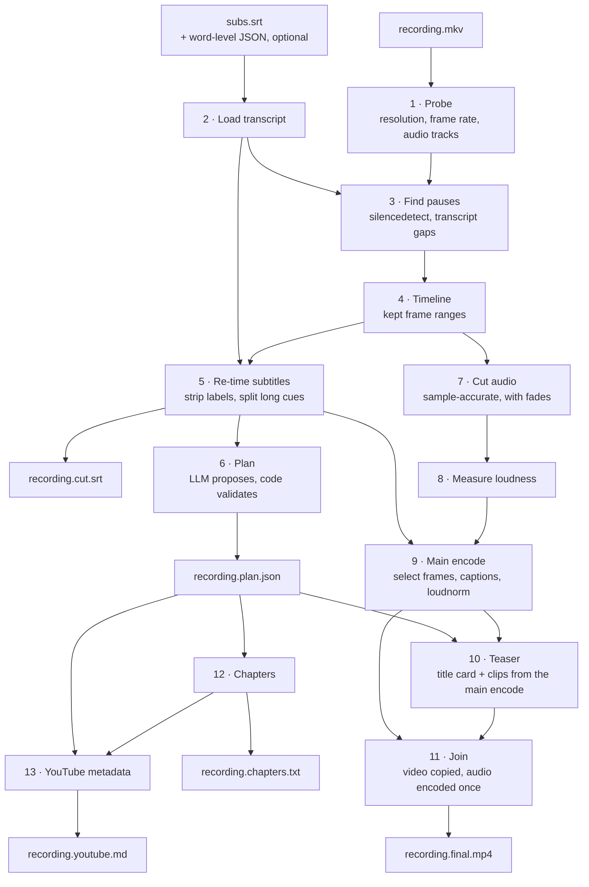

# How Pare works

Pare is a pipeline of small steps around FFmpeg. Only one of them (the main encode) is slow; everything before it decodes audio only or works on text.

## 1. Probe

`ffprobe` reports the resolution, frame rate, duration and audio tracks. Pare prints which audio track it will use, because OBS can record several (`--audio-track N`, `--mix-tracks`).

Output is always constant frame rate. If the recording dropped frames, or is otherwise variable-rate, the video is first resampled to its nominal rate (or `--fps`) so that frame numbers are stable.

## 2. Load the transcript

Pare reads the SRT (comma or dot milliseconds, CRLF, BOM, missing index lines and multi-line cues are all fine). If a Whisper-style JSON with word timings is available (`--transcript <Parley folder>` or `--words file.json`), the words are loaded too.

## 3. Find pauses

By default (`--cut-by audio`) FFmpeg's `silencedetect` finds stretches quieter than the threshold for at least `--min-silence` seconds. The threshold is −35 dB, lowered automatically when the recording itself is quiet, so that soft speech is not mistaken for silence.

A little of each pause is kept on both sides of speech (`--pad`), so cuts do not feel clipped.

The transcript is a second signal:

- `--cut-by subs` treats gaps in the transcript as pauses and ignores the audio level. This is the mode for noisy rooms, keyboard clatter and background music, where the audio is never "silent".
- `--cut-by both` cuts where either signal says so.
- Whenever word timing is available, a cut is trimmed so it never lands inside a word.
- `--remove-fillers` removes whole filler words ("um", "uh") using their word timings.

## 4. Build the timeline

The pauses become a list of kept **frame ranges**. Cuts are moved inward to whole frames, so no more is removed than was asked for. Kept fragments shorter than `--min-keep` would flash by as flicker: a fragment with no speech in it is dropped, otherwise it is joined to its neighbour.

Everything after this point is derived from that one list, which is what keeps audio, video, subtitles and chapters consistent.

## 5. Re-time the subtitles

Speaker labels are stripped (unless `--keep-speakers`). A cue that repeats the one before it with the same text and times is dropped; Parley writes those when one microphone was recorded on two tracks. Cues longer than two lines of 42 characters are split into several, preferring to break at the end of a sentence, and each is wrapped into balanced lines. Then every cue is moved onto the edited timeline: cues inside removed sections disappear, cues that were partly cut are shortened. The result is written to `recording.cut.srt`.

## 6. Plan the teaser, chapters and metadata

The re-timed subtitles are sent to the LLM command as `[start-end] text` lines with a description of what is wanted. This happens _before_ the long encode, so an LLM problem costs seconds rather than minutes.

Pare does not trust the answer. In code it checks the shape, clamps times to the video, snaps clip and chapter times to subtitle boundaries, drops overlapping clips and enforces YouTube's chapter rules. If the answer breaks a rule, the LLM is asked once more with the list of problems. A second answer that is still not usable is an error; one that merely breaks a style rule is repaired and accepted with a warning.

The plan is saved as `recording.plan.json`. `--plan FILE` uses a plan as written and skips the LLM.

The same answer drafts the YouTube metadata: three title options, the opening paragraphs of the description, tags, a pinned comment that asks viewers a question, and three file names for the video (lowercase words joined by hyphens, for recordings still named after the date). Code trims them to YouTube's limits (title 100 characters, description 5,000, tags 500 counted YouTube's way, with commas and quotes around tags that contain a space), removes the `<` and `>` YouTube rejects, and turns each file name into lowercase ASCII words joined by hyphens.

The same request asks for transcript corrections: `{"from", "to", "why"}` for misheard names, products and jargon, judged from the whole transcript. Each `from` must occur in the subtitles. When there are any, Pare prints them with their times in the recording and stops before encoding (on a terminal it offers to apply them all and carry on); the user reviews them in the plan and re-runs with `--plan`. Corrections, and the `vocabulary` from the config (applied without review), change the subtitle text and the word timings together, never times, so the cuts stay where they were; then the subtitles are prepared again as in step 5. The plan's topics, clip labels, chapter titles and YouTube metadata get the same fixes.

## 7. Cut the audio

The chosen track is decoded once to raw samples, and Pare keeps exactly the samples that belong to the kept frames, with a 5 ms fade at every cut so there are no clicks. Sample counts are chosen so the running total always matches the running total of video frames; rounding cannot build up into drift.

## 8. Measure loudness

First pass of `loudnorm` over the cut audio. The second pass, with the measured values, happens inside the main encode. Pare reports whether one constant gain is enough or whether peaks force FFmpeg into its dynamic mode.

## 9. Main encode

The one full re-encode. A single FFmpeg run converts the video to constant frame rate, selects the kept frames, burns the captions (an ASS script generated by Pare, rendered by libass) and applies the loudness gain to the cut audio. The output is H.264 with uncompressed audio. With `--encoder` the H.264 encode runs on the GPU (NVENC, VAAPI or VideoToolbox) while everything else stays on the CPU; Pare checks the encoder works before anything else is done.

## 10. Teaser

The title card is drawn with `drawtext` from text files, so topics containing `%`, `:`, quotes or backslashes appear exactly as written; the font size shrinks if a line would not fit. Highlight clips are cut from the finished main encode, so they already have captions and the right loudness. Each clip fades in and out and carries a small badge in the top-left corner ("Coming up 2/3 · The fix": its place in the teaser and the label the plan gives it), so nobody takes it for the start of the video. After the last clip a short splash card ("Let's get started") marks where the video proper begins; when the title card is in that position (`--teaser-order clips-first`) it does that job and no splash is added. The splash can be an image instead (`--splash-image`), and `--outro-image` adds one after the video.

## 11. Join

Card, clips, splash, main video and outro are joined with FFmpeg's concat demuxer. Video is copied without re-encoding; audio is encoded to AAC once, across the whole programme, so there are no gaps or clicks at the joins. The result is written to a temporary file and renamed into place only when it is complete.

## 12. Chapters

Chapter times are shifted by the length of the teaser. A teaser of 10 seconds or more becomes its own first chapter ("Highlights"). YouTube's rules are enforced: first chapter at 00:00, at least three chapters, each at least 10 seconds. With `--embed-chapters` the same list is also stored in the MP4.

## 13. YouTube metadata

When the plan has metadata, `recording.youtube.md` collects it for the upload form. The description is assembled there: the LLM's paragraphs, then the final chapter list exactly as in `recording.chapters.txt`, then `description_footer` from the config (links, socials). If the whole is longer than YouTube's 5,000 characters, the paragraphs are shortened; the chapters and footer stay whole. A plan without metadata (one written before Pare asked for it, or one where it was deleted) writes no file.

## What gets written

| File                  | What it is                                                          |
| --------------------- | ------------------------------------------------------------------- |
| `<name>.final.mp4`    | H.264 (CRF 18), `yuv420p`, AAC 192 kb/s 48 kHz stereo, `+faststart` |
| `<name>.chapters.txt` | Lines of `MM:SS Title` for the YouTube description                  |
| `<name>.plan.json`    | Topics, clips, chapters, metadata and transcript fixes, editable    |
| `<name>.youtube.md`   | Title options, description with chapters, tags, comment, file names |
| `<name>.cut.srt`      | Subtitles matching the edited video                                 |
| `<name>.pare-work/`   | Intermediates; removed on success unless `--keep-work`              |
